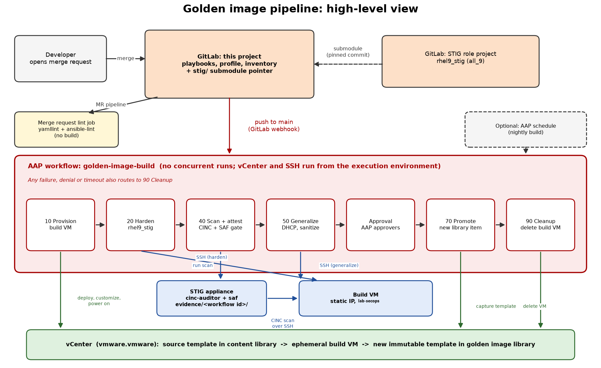

# Custom Golden Image Pipeline (RHEL 9)

GitOps source for RHEL 9 non-production golden images. One AAP workflow deploys an ephemeral D&T build VM from a pinned Content Library template, applies `rhel9_stig` (`stig_component: [all_9]`), scans it from the STIG appliance, attests, and publishes a **new** Content Library template.

Setup (GitLab, AAP, first run): [SETUP.md](SETUP.md).

## Layout

- `profiles/rhel9-nonprod-base/` — `profile.yml` (source, placement, promotion, `stig_component`) and `thresholds.yml` (SAF compliance gate)
- `playbooks/` — numbered build stages, one AAP job template each
- `inventories/build/` — `build_vm` and `stig_appliance` hosts, plus shared defaults in `group_vars/all.yml`
- `stig/` — the separately maintained STIG role project (git submodule)
- `cinc/` — the separately maintained CINC/InSpec profile project (git submodule)

## How builds start

| Event | Result |
|---|---|
| Push to `main` here, including a merge request merge | AAP workflow starts (GitLab webhook) |
| Merge request opened or updated | Lint job only (`.gitlab-ci.yml`) |
| Change in the STIG role or CINC profile project | Nothing; bump the `stig` or `cinc` submodule here and push to `main` |

A webhook launch always runs the project's default branch. The submodules pin exact STIG role and CINC profile commits, so builds are reproducible.

## Build flow

1. **Provision (10):** deploy from the pinned template, stage the static IP and hostname, power on, wait for SSH.
2. **Harden (20):** `rhel9_stig` runs against the build VM.
3. **Scan and attest (40):** the pinned `cinc/` profile is copied to the appliance, CINC scans the build VM from the STIG appliance, `saf validate threshold` is the pass/fail gate, and the attestation is written only if it passes.
4. **Generalize (50):** return the VM to DHCP, reset the hostname, clear Ansible scratch space.
5. **Approval, then promote (70):** publish a new template named `<profile>-<sha>-<workflow job id>`.
6. **Cleanup (90):** delete the build VM. Runs after promote and after any failure.

The static build network values and appliance settings live in `inventories/build/group_vars/all.yml`, never in a profile.

## `lab-secops`

`lab-secops` is the permanent operational account for all SSH: AAP to the build VM and appliance, and the appliance's CINC scan of the build VM (`ansible_user` in `inventories/build/group_vars/all.yml`). Generalization never removes it or `/home/lab-secops/.ssh`, and the `rhel9_stig` fapolicyd rules keep `~/.ansible/` executable, so Ansible still connects to the promoted image.

## Compliance evidence

Each run writes `/home/lab-secops/evidence/<workflow job id>/` on the STIG appliance: `cinc-report.json`, `summary.md`, `rhel9.ckl`, `thresholds.yml`, and `attestation.json`. The CINC console output is in the AAP job log.

Regenerate the thresholds baseline from a known-good run with `saf generate threshold`.
